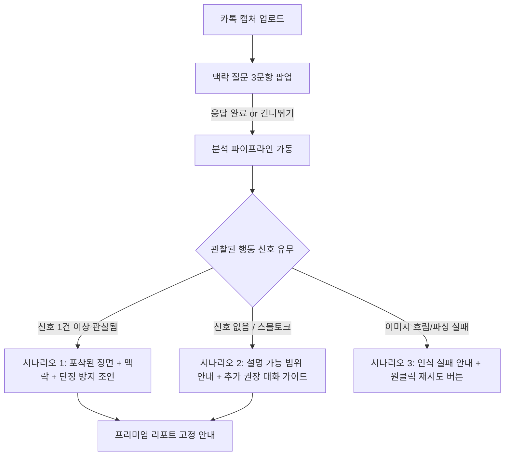

# [구현 계획서] 무료 분석 고도화 & 3대 맥락 질문(Intake) 도입

- **문서 버전**: v1.0
- **작성일자**: 2026-10-26
- **목표 범위**: 
  1. 카톡 캡처 업로드 시 **3대 맥락 질문(선택형 + 건너뛰기 가능)** 모달 도입
  2. 무료 결과 페이지 카피라이팅 & 라벨링 개편 (단서 부족/평화로운 대화 자의적 단정 워딩 제거)
  3. 데이터 3단계 분리 원칙(관찰 팩트 vs 유저 진술 vs 종합 해석) 및 고급 라인 SVG UI 적용
  4. 라이브 운영 환경의 무장애·무리스크 보장 (결제 연동 및 핵심 파이프라인 100% 보존)

---

## 1. 아키텍처 및 안전성 원칙 (Operational Safety)

### 1.1 Non-breaking (무중단·무리스크) 원칙
- **결제 파이프라인 무변경**: NICEPAY 결제, 주문 생성, 리턴 URL, 웹훅은 단 1줄도 수정하지 않음.
- **DB 스키마 마이그레이션 불필요**: 새로 수집되는 맥락 질문은 기존 `analyses.derived_context` JSONB 필드 내에 안전하게 보관.
- **Fail-safe (건너뛰기 지원)**: 사용자가 질문에 답하지 않거나 건너뛰더라도 기존 업로드·분석 파이프라인이 100% 그대로 실행됨.

---

## 2. 세부 개발 작업 명세 (Task Breakdown)

### Task 1. 맥락 질문 모달 컴포넌트 개발 (`ContextIntakeModal.tsx`)
- **위치**: `src/components/upload/ContextIntakeModal.tsx` (신규 분리)
- **트리거**: 캡처 이미지 업로드 완료 직후(분석 시작 전) 가벼운 바텀시트/모달로 노출.
- **3대 질문 구성**:
  1. **Q1. 이 대화 당시 어떤 상황이었나요?**
     - 선택지: `평소 일상` | `서운함·다툼` | `시간을 갖는 중` | `이별 전후` | `기타·모름`
  2. **Q2. 이번에 고민되는 반응이 이전에도 있었나요?**
     - 선택지: `처음` | `가끔 반복` | `자주 반복` | `판단하기 어려움`
  3. **Q3. 이번 분석에서 가장 알고 싶은 것은?**
     - 선택지: `대화의 의미` | `반복되는 관계 패턴` | `어떻게 답할지` | `앞으로 무엇을 확인할지`
- **UX 인터랙션**:
  - 각 문항 1클릭 단일 선택 (총 3번 터치로 5~10초 만에 완료).
  - 상단 또는 하단에 `[건너뛰고 바로 분석하기]` 링크 제공.
  - 완료 시 `onComplete(intakeData)` 호출 후 분석 시작.

### Task 2. 분석 API 및 저장소 연동 (`route.ts` & `analysisRepository.ts`)
- **수정 파일**: `src/app/api/analyze/route.ts`
- **변경 사항**:
  - `POST` Body에서 `context_intake` 객체 수신 (선택 사항):
    ```ts
    interface ContextIntake {
      situation?: string;     // 예: "서운함·다툼"
      recurrence?: string;    // 예: "자주 반복"
      desired_focus?: string; // 예: "어떻게 답할지"
    }
    ```
  - `buildDerivedReportContext`에 `context_intake` 전달하여 LLM이 맥락을 참고하도록 주입.
  - `persistentPayload.derived_context.context_intake`에 저장하여 결과 페이지에서 조회 가능하도록 매핑.

### Task 3. LLM 프롬프트 가이드라인 보강 (`prompt.ts`)
- **수정 파일**: `src/lib/analysis/mvp/prompt.ts`
- **지침 추가**:
  - *"사용자가 추가로 응답한 배경 맥락(context_intake)은 대화 해석의 참고용으로만 사용하라."*
  - *"사용자가 '자주 반복'을 선택했더라도 카톡 캡처 내 관찰 신호(v) 점수를 인위적으로 올리지 마라."*
  - *"결과 해설 시 사용자의 고민(`desired_focus`)을 우선적으로 고려하여 실질적인 맞춤형 조언을 생성하라."*

### Task 4. 무료 결과 화면 UI 전면 개편 (`page.tsx` & `types.ts`)
- **수정 파일**:
  - `src/lib/analysis/types.ts` (`getAnalysisUiPresentation`)
  - `src/app/result/[id]/page.tsx`
- **핵심 UI 변경점**:
  1. **헤더 & 판정 상태 표현**:
     - `insufficient_all` 상태일 때 "단서 부족" ❌ ➔ **"특정 애착 방어기제가 드러난 장면이 확인되지 않았어요 (설명 가능 범위 안내)"** ⭕
     - "평화로운 대화", "서로 배려하는 대화" 등 감정적 단정 워딩 완전 박멸.
     - 미세 신호 관찰 시 (예: 회피 1건): "회피 33점" 대신 **"갈등 상황 대화 유보 표현 1건 관찰"** 뱃지 노출.
  2. **01. 분석 근거 섹션의 3분법 적용**:
     - 🔍 **대화에서 관찰된 장면**: 카톡 팩트 요약
     - 📋 **사용자가 알려준 맥락**: Q1~Q3 응답 팩트 요약 ("서운함·다툼 상황이며, 이전에도 자주 반복되었다고 응답해 주셨어요.")
     - 💡 **심리 분석가의 통합 소견**: 두 정보를 종합한 조심스러운 해석 및 단정 방지 조언
  3. **02. 맞춤 추천 조언 섹션**:
     - Q3(`desired_focus`)에서 고른 항목에 따라 맞춤 팁 노출:
       - "어떻게 답할지" ➔ **상황별 추천 발화문 및 즉시 실천 팁** 강조
       - "반복되는 관계 패턴" ➔ **갈등 핑퐁 패턴 분석** 강조
  4. **디자인 퀄리티**:
     - OS 기본 이모지 전면 배제.
     - SVGRepo 스타일의 1.5~2px 톤온톤 미니멀 라인 SVG 아이콘 적용.

---

## 3. 세부 상태별 화면 시나리오 정의



---

## 4. 검증 및 롤아웃 계획 (Verification Plan)

### 4.1 빌드 및 타입 안정성 검증
- `npm run build`를 실행하여 모든 TypeScript 타입 에러 및 린트 검사 100% 통과 확인.
- 이전 데이터(기존 DB에 저장된 분석 결과) 조회 시 `context_intake`가 없는 경우(`undefined`)에도 화면이 깨지지 않고 자연스럽게 렌더링되는 하위 호환성(Backward Compatibility) 검증.

### 4.2 사용자 경험(UX) 테스트 시나리오
1. **스킵 케이스**: 질문 3개를 모두 건너뛰었을 때 기존과 동일하게 분석이 정상 완료되는지 확인.
2. **응답 케이스**: 질문 3개를 선택했을 때 결과 페이지에 유저의 응답 맥락이 자연스럽게 반영되는지 확인.
3. **0점/0점 케이스**: 오늘 접수된 일상 대화(사인볼/약속 조율) 케이스 조회 시 "단서 부족"이 아닌 "설명 가능 범위 안내"로 우아하게 표시되는지 확인.
4. **결제 테스트**: 무료 결과 화면에서 2,900원 결제 버튼 클릭 시 결제창이 정상 호출되는지 무결성 확인.
